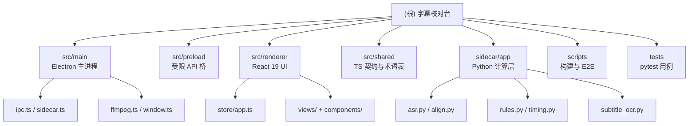

# 字幕校对台（Subtitle Auditor）— AI 开发上下文

## 变更记录 (Changelog)

- 2026-11-12T21:44:30 初始化架构文档：根级 CLAUDE.md、7 个模块 CLAUDE.md、`.claude/index.json`。

> 面向 AI 的工程上下文。用户功能、审查口径与发布说明见 `README.md`，本文不重复。

## 项目愿景

Windows 桌面端本地视频字幕审查工具。以本地 ASR 的词级置信度与字幕文本差异为依据，定位疑似错别字、内容不一致与时间轴偏移；视频无字幕时，可从画面提取硬字幕。所有媒体与推理均在本机完成，不上传、不自动改写字幕文件，只给出证据与建议。

## 架构总览

三层进程边界：

- **Electron 主进程**（`src/main`）：窗口与生命周期、文件对话框、ffmpeg 探测/转码/字幕轨提取、导出、设置持久化、自动更新、sidecar 子进程管理。
- **渲染进程**（`src/renderer`）：React 19 + Zustand，只通过 preload 暴露的 `window.api` 调用系统能力。
- **Python sidecar**（`sidecar/app`）：媒体解析、字幕解码、faster-whisper 识别、长文本对齐、拼音判定、时间轴规则、OCR 抽取。

通信方式：主进程与 sidecar 之间是 stdio 上的逐行 JSON-RPC 2.0。请求带 `id`；事件不带 `id`（`progress`、`asr.segment`、`job.done`、`job.error`、`model.progress`、`ocr.progress`、`log`）。Python dataclass 经 `schema.jsonable` 转为 camelCase，与 `src/shared/contracts.ts` 的接口一一对应。

审查流水线：

```
ffprobe 探测
  → pysubs2 解析字幕（BOM/UTF-8/GB18030/charset-normalizer 探测编码）
  → faster-whisper 识别（VAD、word_timestamps、术语 hotwords、繁转简）
  → 文本归一化（全半角、数字、单位、CAN-H/L、符号）
  → difflib + rapidfuzz 对齐（单条/合并字幕、全局偏移、渐进漂移）
  → 拼音同音/近音判定 + 边缘截断/ASR 插入噪声抑制
  → Finding / Summary → 结果页、Excel/CSV/JSON 导出
```

## 模块结构图（Mermaid）



## 模块索引

| 模块 | 职责 | 语言 | 入口 |
|------|------|------|------|
| `src/main` | 主进程：窗口、IPC、sidecar 生命周期、ffmpeg、设置、导出、更新 | TypeScript | `src/main/index.ts` |
| `src/preload` | `contextBridge` 暴露受限 `window.api` | TypeScript | `src/preload/index.ts` |
| `src/renderer` | 首页、处理中、结果页、OCR、设置页与播放器/时间轴 | TypeScript / React | `src/renderer/src/main.tsx` |
| `src/shared` | TS 契约、IPC 通道常量、术语表预设 | TypeScript | `src/shared/contracts.ts` |
| `sidecar/app` | 媒体、字幕、ASR、对齐、规则、时间轴、OCR、模型管理 | Python | `sidecar/run.py` → `sidecar/app/main.py` |
| `scripts` | 环境安装、sidecar 打包、ffmpeg 获取、图标、E2E/截图 | Node.js (ESM) | `scripts/setup-sidecar.mjs` |
| `tests` | sidecar pytest 用例、媒体样片、E2E 产物 | Python / 脚本 | `tests/sidecar/conftest.py` |

## 运行与开发

环境：Node.js 22（CI 使用）、npm、Python 3.13；`uv` 可选，缺失时脚本回退 `py -3.13 -m venv` + `pip`。

```bash
npm install
npm run setup:sidecar     # 创建 sidecar/.venv 并安装 sidecar/requirements.txt
npm run fetch:ffmpeg      # 复制 ffmpeg-static / ffprobe-static 到 resources/ffmpeg
npm run dev               # electron-vite dev
npm run typecheck         # tsc node + web，两个 project 都需通过
npm run build             # electron-vite build → out/
```

打包与发布：

```bash
npm run dist              # build:sidecar → fetch:ffmpeg → build → electron-builder NSIS
# 产物固定为 dist/SubtitleAuditor-Setup-<version>.exe 与 latest.yml / blockmap
```

- 打包前先关闭正在运行的实例；输出目录固定为 `dist/`，不要新建并行的输出目录。
- Python 改动必须先 `npm run build:sidecar`，否则安装包内仍是旧的 `resources/sidecar`。
- 发布：推送 `v*` tag 触发 `.github/workflows/release.yml`，先创建 draft 再校验 `latest.yml`、exe、blockmap 后发布；本地发布需 `GH_TOKEN`。

运行时路径：

- 开发用户数据：`%APPDATA%\SubtitleAuditorDev`；打包版：`%APPDATA%\SubtitleAuditor`。
- 模型/GPU/缓存：`%LOCALAPPDATA%\SubtitleAuditor\{models,gpu,cache}`。
- 设置文件：`%APPDATA%\SubtitleAuditor\settings.json`。
- 开发 sidecar：`sidecar/.venv/Scripts/python.exe sidecar/run.py`；打包版：`resources/sidecar/SubtitleAuditor.exe`。

测试钩子：未打包时，`SUB_AUDITOR_TEST_VIDEO` 与 `SUB_AUDITOR_TEST_SUBTITLE` 可跳过文件对话框直接返回路径。

## 测试策略

- **Python 单测**：`npm run test:sidecar`（等价 `sidecar/.venv/Scripts/python.exe -m pytest tests/sidecar -q`）。覆盖对齐、归一化、拼音、规则、时间轴、术语改写、OCR 片段合并、RPC 编码、设备解析。
- **E2E**：`scripts/e2e.mjs`、`actions.mjs`、`screenshot.mjs`、`verify-installed.mjs` 通过 Playwright CDP 连接已启动的应用；需要应用以远程调试端口启动（当前仓库未封装该启动命令，属已知缺口）。产物写入 `tests/output/`（已忽略）。
- **类型检查**：`npm run typecheck` 是唯一的 TS 静态门禁；没有 TS 单元测试框架。
- **CI**：发布工作流只跑 `typecheck`、构建与打包，不跑 pytest。

## 编码规范

- TypeScript `strict`、`noUnusedLocals`、`noUnusedParameters`；别名 `@shared/*`、`@renderer/*`。
- 渲染进程不得直接使用 Node/Electron；所有能力必须经 preload 的 `Api` 与方法白名单。新增 IPC 需同时改 `src/shared/ipc.ts`、`src/preload/index.ts`、`src/main/ipc.ts`。
- Python 侧 wire contract 以 `sidecar/app/schema.py` 的 dataclass 为准，输出统一走 `jsonable()`；`stdout` 只允许 JSON-RPC 行，日志写 `stderr`。
- 阈值一律来自 `AnalysisOptions`，不要在规则代码里硬编码新的用户可见阈值。
- 只审查、不改写字幕文件；OCR 只生成新的 `.ocr.srt`。
- 注释与文档遵循“非必要不形成”，解释“为什么”而非复述代码。
- 不编辑生成目录：`node_modules`、`out`、`dist*`、`resources/sidecar`、`resources/ffmpeg`、`sidecar/.venv`、`sidecar/dist`、`tests/output`、`.ccg`、`.context`。

## AI 使用指引

1. **改分析结果结构**：先改 `src/shared/contracts.ts` 与 `sidecar/app/schema.py`，再同步 `main.py` 的组装、`export.ts`、结果页与 Excel/CSV 列；最后更新 `index.json` 的 schemaVersion 说明。
2. **改审查规则**：规则入口在 `sidecar/app/rules.py`（文本/错别字）与 `timing.py`（时间轴）；必须补充或调整 `tests/sidecar/test_rules.py`、`test_timing.py`，并与 README 的“审查口径”保持一致。
3. **改对齐/归一化**：`align.py` 的归一化映射必须保持字符偏移可回溯（`source` 数组）；任何新单位/符号都要补 `test_align.py`。
4. **改 UI**：状态集中在 `src/renderer/src/store/app.ts`；结果页快捷键在 `ResultsView.tsx`；导出会剔除“已忽略”并重算 `summary.counts`。
5. **改 sidecar 协议**：方法在 `main.py:dispatch` 注册；同步 `SidecarClient` 的调用、超时和 `shared/ipc.ts` 的返回类型。
6. **打包验证**：`typecheck` → `test:sidecar` → `npm run dist`；确认 `dist/latest.yml` 版本号与 `app-update.yml` 存在。

已知陷阱：

- 对齐游标必须停留在 ASR 时间轴（`align.py` 中 `minimum` 用 `end_ms - effective_offset`），否则全局偏移会让相邻字幕吞词。
- 词级置信度取对齐词的最小值；低置信度只能降级为“不确定”，不能断言字幕错误。
- 边界处多出/漏掉的少量字词只标“语音边界差异”，且不再据此报告该端点时间偏差。
- OCR 来源的 `timingToleranceMs` 自动放宽到 1500 ms（`options.ocrSource`）。
- `sidecar/app/compat.py` 必须在 faster-whisper 导入前生效，用于移除 PyAV 19 已删除的 `metadata_errors` 参数。
